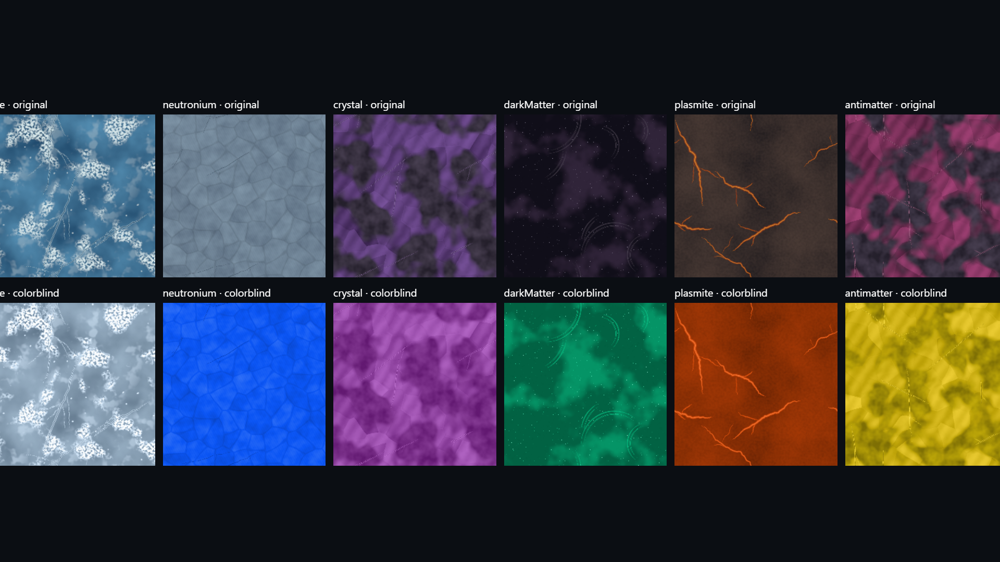
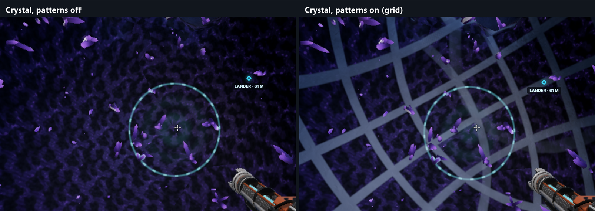
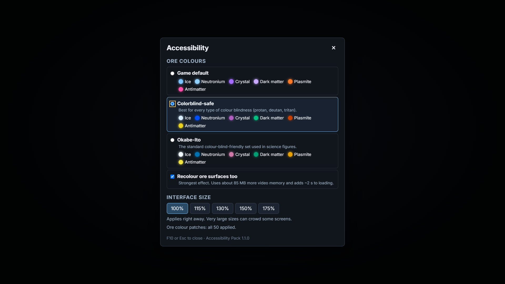

# No Asteroids mods

Unofficial tools for **No Asteroids** (Steam, 2026): a save backup tool, a mod loader, and an accessibility pack with colour-blind-safe ore colours and interface scaling.

| Folder | What it is |
|---|---|
| [save-backup](save-backup/README.md) | Backs up and restores your saves, including Steam Cloud slots. Doesn't touch game files. |
| [modloader](modloader/README.md) | Loads mods from a `mods` folder: scripts, styles, asset replacements and code patches. |
| [mods/accessibility](mods/accessibility/README.md) | Colour-blind-safe ore palettes, ore patterns, glow halo strength, a plainer font and interface scaling, switchable live with **F10**. |

## Quick start (Windows)
1. Download this repository (**Code → Download ZIP**) and unzip it anywhere.
2. Run `save-backup\Back up saves.bat`.
3. Close the game, then run `modloader\Install mod loader.bat`.
4. Start the game and press **F10**.

**After every game update**, run `Install mod loader.bat` again. Updates replace the modded files with the originals.

To remove everything, run `modloader\Uninstall mod loader.bat`. It restores the original game files.

## Why the accessibility pack
Several of the game's glowing ores are hard to tell apart:
- **Ice and neutronium** look almost the same for everyone.
- **Ice and dark matter** become identical with deuteranopia, the most common type of colour blindness.

The pack recolours each ore's surface, glow and dig trail, and you can switch palettes live in game. For players who can't rely on colour at all, it can also draw a **pattern** on each glowing ore: dots, stripes, grid, checks, zigzag or rings.

 A colour-vision simulation measured on the in-game surfaces puts the closest pair of ores at CIELAB ΔE 23.7 or more for every type of colour blindness, up from 6.5 in the stock game. Details are in the [pack's README](mods/accessibility/README.md).

## Multiplayer (co-op)
- The accessibility pack only changes what **your** screen shows. Each player can pick their own palette, and players without the mod can join you as normal.
- The mods never touch world generation or meshing, so the asteroid is built exactly as in the stock game for everyone.
- Co-op only checks that everyone runs the same game version. The mods don't change it.

## Tested on
- No Asteroids 1.0.7 (full game)
- No Asteroids, Steam build 26904996 (full game)
- No Asteroids Demo, build 1.0.0-3edb4ef20

The installer checks the game's code before patching anything. If a future update changes it, the installer stops without changing any files, and the F10 panel reports any patches that didn't apply.

## Please read: what the installer changes
The game is an Electron app. Its exe stores a SHA-256 hash of its game archive (`resources\app.asar`) and won't start if the archive changes. To load mods, the installer:
- backs up the original archive and exe to `<game>\mods\_backup`
- rebuilds the archive with three small changes
- writes the new archive's hash into the exe, so the game's own integrity check stays **on** and passes

As a result, the exe's digital signature no longer matches. Windows and Steam don't require it, and uninstalling restores the signed original. Steam's "Verify integrity of game files" also restores the originals.

This project is **not affiliated with or endorsed by the developers of No Asteroids**. Use it at your own risk, and **uninstall the loader before reporting a bug to the developers**. A "Modded" tag shows in a corner of the screen for the first seconds of each launch, so screenshots make this clear.

## License
[MIT](LICENSE)
