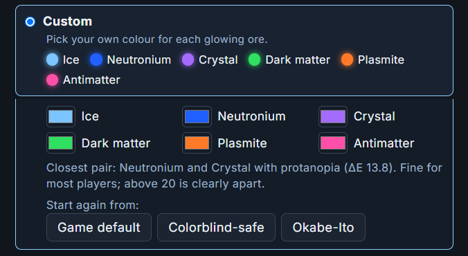

# Accessibility Pack

Press **F10** in game to open its settings.

## Ore colours (colour blindness)
The game's glowing ores use colours that are hard to tell apart:
- **Ice and neutronium** look almost the same for everyone.
- **Ice and dark matter** become identical with deuteranopia (the most common type of colour blindness).

The pack recolours each ore's **surface texture**, its glow, its dig trail and its voxel colour. The texture recolour keeps each pixel's brightness, so the texture detail stays: plasmite's veins, dark matter's star specks, crystal's facets.

| Palette | Use it for |
|---|---|
| **Colorblind-safe** | Any type of colour blindness. Every pair of glowing ores stays clearly apart for normal, protan, deutan and tritan vision. |
| **Okabe-Ito** | The well-known colour-blind-friendly set used in science figures. |
| **Custom** | Your own colour for each glowing ore. See [Your own colours](#your-own-colours). |
| Game default | No change. |

The palettes were checked with a colour-vision simulation (Machado et al. 2009, full severity). Each table shows the closest pair of glowing ores, in CIELAB ΔE; under ~10 means easily confused.

**What you see: the average colour of each ore's surface, measured in game**

| | normal | protan | deutan | tritan |
|---|---|---|---|---|
| Game default | 8.4 | 6.5 | 8.4 | 9.0 |
| **Colorblind-safe** | **46.1** | **25.6** | **35.6** | **23.7** |

**Glow colours alone**

| | normal | protan | deutan | tritan |
|---|---|---|---|---|
| Game default | 8.0 | 7.2 | **0.6** | 6.2 |
| Okabe-Ito | 35.1 | 22.7 | 17.0 | 17.0 |
| Colorblind-safe | 35.9 | 35.9 | 35.9 | 35.9 |

### Surface recolouring and your graphics card
The game ships ore textures compressed for the GPU. To recolour them, the pack decodes them with the game's own decoder. This adds about 2 seconds to loading and uses about 85 MB more video memory. On a weak GPU, untick **Recolour ore surfaces too** in the F10 panel; the glow and trail colours still change. If decoding ever fails, the game keeps its original textures.

Each ore keeps its character: ice stays pale, neutronium blue, crystal purple, dark matter green, plasmite fiery orange and antimatter yellow. Dark ores stay dark.

Changes apply **live**, with no restart. Switching surface recolouring on takes about a second, the first time.

### The game's own ore colours (1.0.7 and later)
The **Scanner** section of the game's own settings can now recolour or hide each ore on the scanner, the ore tags and the hit marker. The two work together:
- The pack recolours the ores themselves: surfaces, glow and trails.
- The game's setting recolours the scanner.

If you set a scanner colour in the game, it wins on the scanner.

### Multiplayer (co-op)
The pack only changes what **your** screen shows, so each player can pick their own palette, and players without the mod can join you as normal.
- It never touches the game's world-generation or meshing code, so the asteroid is built exactly as in the stock game for everyone.
- Co-op only checks that everyone runs the same game version. The mod doesn't change the version.

### Your own colours
Pick **Custom** in the F10 panel. A colour picker appears for each glowing ore, starting from the palette you had on.



- Ores recolour live when you close a picker.
- Under the pickers, the panel shows how far apart your two closest ores stay, using the same colour-vision simulation as the tables above, across normal, protan, deutan and tritan vision:
  - **ΔE under 12:** a warning names the pair and suggests changing one or turning on ore patterns.
  - **12 to 20:** fine for most players.
  - **Over 20:** clearly apart.
- **Start again from** resets the pickers to one of the built-in palettes.

The check uses the glow colours. Surface textures keep their own detail and brightness, so in game the ores usually look a little further apart than the number suggests.

For more control, edit `mods\accessibility\settings.json`. The panel saves its pickers here too:
```json
{
  "palette": "custom",
  "custom": {
    "ice":        { "glow": "#ffffff" },
    "antimatter": { "glow": "#ff00ff", "trail": "#ff80ff" },
    "iron":       { "trail": "#ff0000", "rgb": "#a05030" }
  }
}
```
The ores are `ice iron nickel titanium gold crystal plasmite neutronium darkMatter antimatter`. For each one you can set:
- `glow`: the glow colour (glowing ores only)
- `trail`: the dig trail colour (follows `glow` if left out)
- `tex`: the surface colour (follows `glow` if left out)
- `texMix`: how strongly to recolour the surface, from `0` (original) to `1` (full); the default is `0.9`
- `rgb`: the base voxel colour

## Ore patterns (no colour needed)
Tick **Draw a pattern on each glowing ore** to draw a shape on each glowing ore. You can then tell ores apart even if you can't rely on colour at all: with monochromacy, in shadow, or where the glow washes the colour out.

| Ore | Pattern |
|---|---|
| Ice | dots |
| Neutronium | stripes |
| Crystal | grid |
| Dark matter | checks |
| Plasmite | zigzag |
| Antimatter | rings |

- The pattern darkens light ores and lightens dark ones, so it stays visible on every ore.
- It fades out at a distance, so far-off rock doesn't shimmer.
- **Bold** and **Subtle** set how strong it is.
- It works with any palette, and switching is instant.

The shader draws the patterns live, so they cost no extra video memory. Like the colours, they only change your own screen.

To change a pattern or its size, edit `settings.json`:
```json
{
  "patterns": true,
  "oreHints": { "gold": "stripes", "ice": "rings" },
  "patternScale": 0.5
}
```
- Patterns: `none stripes dots checks grid zigzag rings`
- `patternScale`: pattern cells per voxel. Lower it for bigger shapes, raise it for smaller ones. The default is `0.5`.

## Glow halo
Sets the soft bloom halo around bright ores and lights to 100%, 75%, 50%, 25% or off. Turn it down for less glare. This changes only the halo: ores still glow.

The game's own **Settings** already cover **Camera shake**, **Impact flashes**, **Field of view**, hold-or-toggle for the tool (**Click to toggle the tool**) and key remapping, so the pack doesn't duplicate them.

## Interface size
Sizes are 100%, 115%, 130%, 150% and 175%, and changes apply right away. The game's menus and HUD are sized in `rem`, so they scale cleanly.

## Text
- **Easier-to-read font** replaces the game's angular display font (Tektur) with the plain Inter font, with normal letter spacing. A few labels drawn into the 3D world keep the original font until the next launch. The big wall counters always keep it, because they're painted into textures.
- **Text on the station's computer screens** comes in 100%, 115% and 130%. These screens are panels in the 3D world with fixed pixel sizes, so the interface size doesn't reach them.

## If something stops working after a game update
The panel shows whether all of the pack's code patches applied. If some didn't, the game's code changed. The rest of the pack still works, and the game itself is unaffected.
